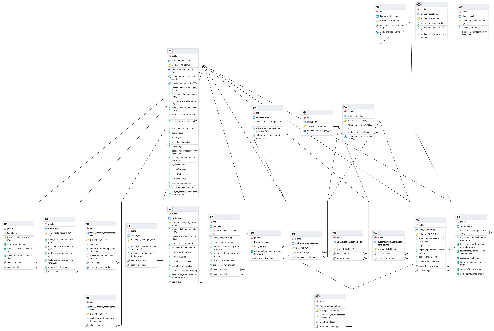
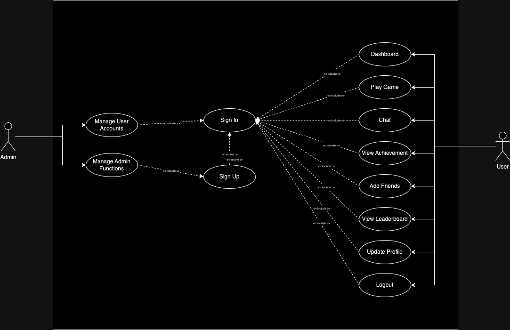

# TopspinPong

- Play Ping Pong matches and tournaments, and chat live with your friends!

## Index

- [Technology Stack](#technology-stack)
- [Usage](#usage)
- [Merise](#merise)
- [Unified Modeling Language](#unified-modeling-language)
- [Features](#features)
- [Ressources](#ressources)

# Technology Stack

| Category               | Technology                                                                                                                                                                                                                                                                                                           |
|------------------------|------------------------------------------------------------------------------------------------------------------------------------------------------------------------------------------------------------------------------------------------------------------------------------------------------------------------|
| **Server**             |                                                                                                                                                                                                                      |
| **Backend Framework**  |                                                                                                                                                                                                      |
| **Database**           |                                                                                                                                                                                                      |
| **Containerization**   |                                                                                                                                                                                                                   |
| **Frontend**           |    |
| **Authentication**     |                                                                                                                                                                                                            |
| **Monitoring and Logging** |     |
| **Languages**          |     |
| **Development Tools**  |    |
| **Design**             |                                                                                                                                                                                                                      |

---

## Usage

```bash
# to see all available commands
$> make

# build images and run containers
$> make start

# to build docker images
$> make build

# to run docker containers
$> make up

# removes containers, volumes... and restart everything
$> make re

# generating some users and matches
$> make data-generator

```

**After running all the containers, you can access <a href='https://localhost' target="_blank">https://localhost</a>**

---

## Merise

### Logical Data Model




[⬆️ Back To Features](#supported-features)

---

## Unified Modeling Language

### Use Case


<!--  -->

- **Sign Up**: This use case allows a new user to create an account on the website. Users will provide necessary information such as username, email, and password to register themselves.
- **Sign In**: This use case enables registered users to authenticate themselves into the system by providing their username/email and password.
- **Dashboard**: Upon signing in, users are directed to their dashboard. The dashboard provides an overview of the user's profile, activities, notifications, and other relevant information.
- **Play Game**: Users can engage in playing games available on the website. This use case allows users to select and participate in various games, such as ping pong, available on the platform.
- **Chat**: Users can communicate with each other through the chat feature provided by the website. This use case enables users to send and receive messages, emojis, and other media in real-time.
- **View Achievement**: Users can view their achievements and milestones attained while using the website. This use case allows users to track their progress and accomplishments within the platform.
- **Logout**: This use case allows users to securely log out of their account, ensuring the privacy and security of their data.
- **Add Friends**: Users can expand their social network by adding other users as friends. This use case enables users to send and accept friend requests, thereby connecting with each other on the platform.
- **View Leaderboard**: Users can view the leaderboard to see rankings based on various criteria, such as game scores, achievements, or activity levels. This use case provides users with a sense of competition and allows them to compare their performance with others.
- **Update Profile**: Users can modify and update their profile information as needed. This use case allows users to edit their profile details, such as username, profile picture, bio, and other preferences.
- **Manage User Accounts**: Admins can manage user accounts, including creating new accounts, updating user information, and deactivating or deleting accounts if necessary.
- **Manage Admin Functions**: Admins have access to additional functionalities for managing the website, such as managing system settings, controlling access permissions, and handling reported issues or disputes.

[⬆️ Back To Features](#supported-features)

---


# Features

| Area | What it does |
|---|---|
| **Game** | Live Pong in the browser, 3D graphics with Three.js/WebGL, custom game options, remote players over WebSockets |
| **Tournaments** | Aliases per tournament, matchmaking and announcements for the next match |
| **Users** | Sign-up and login, OAuth 2.0 single sign-on, avatars, friends and online status, profile stats and match history |
| **Chat** | Direct messages, blocking, game invites from the chat, tournament notifications |
| **Stats** | Dashboards with charts for each player and each game |
| **Security** | Two-factor authentication (2FA), JWT, hashed passwords, input validation, HTTPS and WSS everywhere |
| **Backend** | Django REST API with PostgreSQL |
| **DevOps** | One-command start with Docker Compose, ELK stack for logs, Prometheus and Grafana for monitoring |

The site is a single-page application: the browser's Back and Forward buttons work as expected.

[⬆️ Back to top](#index)

## Ressources

- [NextJS and Cloudinary — App Router Integration](https://medium.com/@varchasvipandey/nextjs-and-cloudinary-app-router-integration-ad7fd2e0fdb2)
- [NextJS 13 API Routes: Better Than Expected!](https://www.youtube.com/watch?v=vrR4MlB7nBI&ab_channel=Joshtriedcoding)
